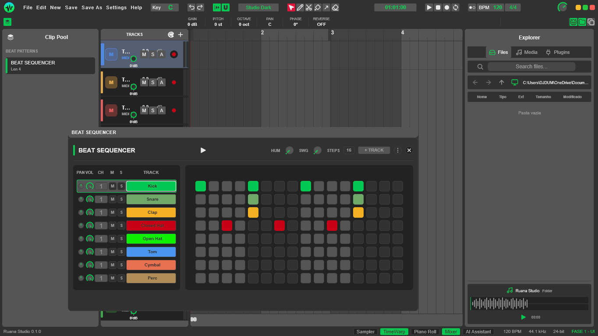
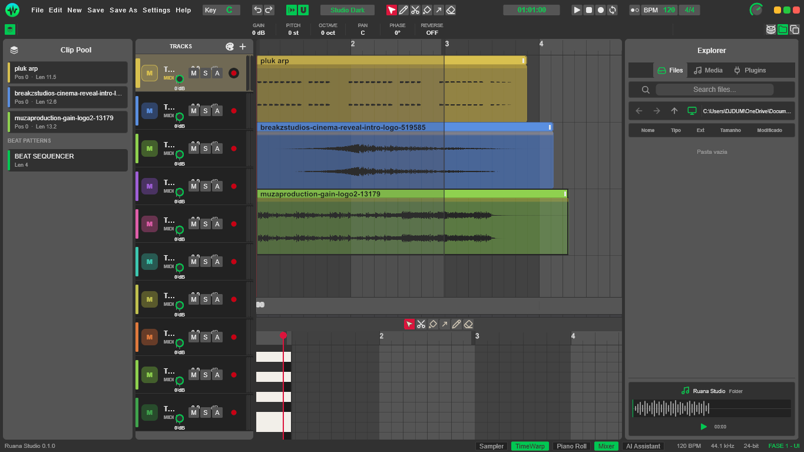
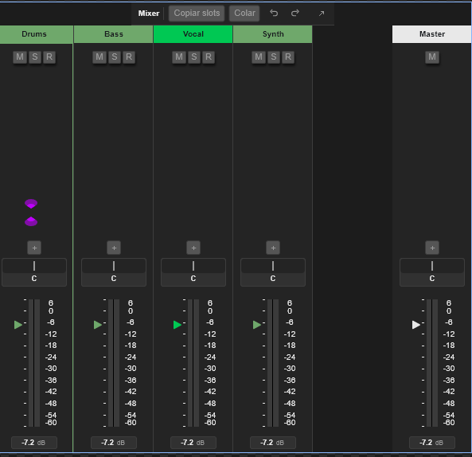
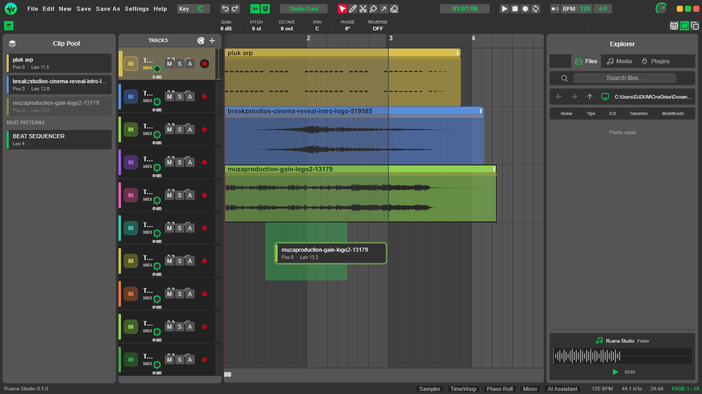
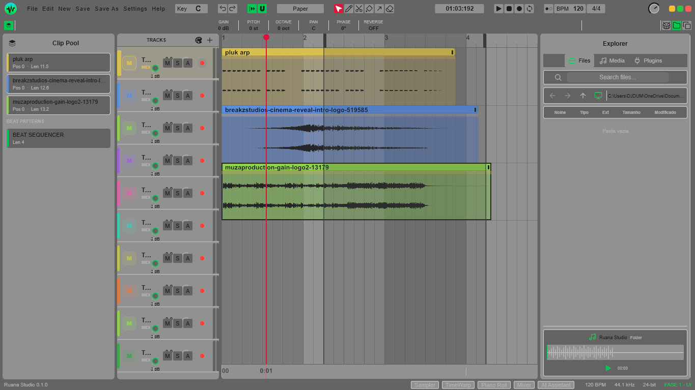
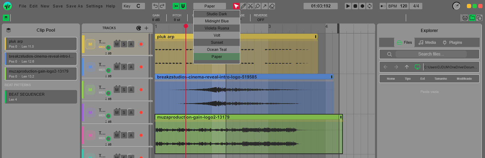

# Ruana Studio

Digital Audio Workstation (DAW) desenvolvida em Rust com interface Slint.

## Sobre

Ruana Studio é uma estação de trabalho de áudio digital com timeline, mixer, plugins e suporte a MIDI/áudio. Construída para performance com renderização GPU e engine de áudio em Rust.

## Screenshots








## Funcionalidades

- Timeline de áudio/MIDI com zoom e scroll
- Mixer com canais e efeitos
- Suporte a plugins
- Renderização de timeline acelerada por GPU
- Projeto salvo em formato próprio

## Build

```bash
cargo build --release -p ruana-studio
```

## Execução

```bash
cargo run -p ruana-studio
```

No Windows (binário já compilado):

```powershell
& 'target\debug\ruana-studio.exe' -p ruana-studio
```

## Estrutura

- `app/` — aplicação principal (UI Slint)
- `crates/daw-core` — núcleo do DAW
- `crates/daw-audio` — engine de áudio
- `crates/daw-midi` — MIDI
- `crates/daw-media` — mídia
- `crates/daw-plugins` — plugins
- `crates/daw-project` — formato de projeto
- `timeline-render/` — renderer da timeline
- `ruana-hub/` — hub

## Contribuidores

<!-- Adicione seu nome abaixo -->
- 

## Licença

A definir.
